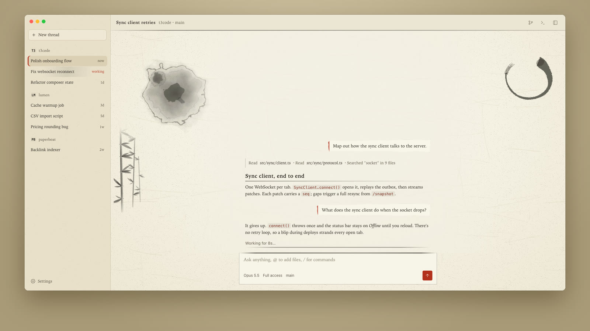

# Washi

**A paper-and-sumi-ink theme for [T3 Code](https://t3.codes).** Nothing moves at rest. While your agent works, ink spreads in the margin and brush lines are drawn. When the turn ends, a vermilion hanko seal is pressed.

**[See it in motion →](https://joshsaintjacque.github.io/t3code-theme-washi/)**



## Install

**From the app**

1. Download [`washi.json`](washi.json), or copy its contents.
2. In T3 Code, open **Settings › Appearance › Add theme**.
3. Choose the file, or paste the JSON, and add it.

**From the terminal**

```sh
curl -fsSL -o washi.json https://joshsaintjacque.github.io/t3code-theme-washi/washi.json
~/.t3/bin/t3 theme set washi.json
```

## What moves, and when

Every animation is tied to app state. If nothing is running, nothing moves. Only transform, opacity and background size or position are animated, always on small elements.

| Trigger | What happens |
|---|---|
| **A turn is running** | An ink bloom spreads in the left margin over about nine seconds (dark core, tide-line ring). Three satellite stains wick out of it at about 3s, 10s and 20s and the bloom keeps creeping outward for a couple of minutes. It never resets on a long turn. |
| **A turn is running** | A brush line is drawn once along the header and under the *Working* row, then stays until the turn ends. |
| **A turn completes** | The hanko seal drops back into the margin and is pressed with a small bounce while the ink dries back to a stain. The seal lifts off when the next turn starts. |
| **A thread is busy in the background** | A pale wash drifts across its sidebar row. |
| **Composer focus** | A line of indigo ink runs under the composer. |
| **Hover a thread** | A brush stroke trails under the row. |
| **Narrow windows (under 1460px)** | The margins are gone, so a small stain and the seal dock in the sidebar's top band beside the window controls, clear of the thread list. |
| **`prefers-reduced-motion`** | Everything freezes: a settled stain, drawn brush lines, the seal in place. |

## Palette

| Role | Hex |
|---|---|
| Canvas (paper) | `#F3EEE2` |
| Sidebar | `#E9E0CB` |
| Message | `#F9F5EA` |
| Code | `#E9E1CD` |
| Text (sumi) | `#28231F` |
| Muted | `#5F564A` |
| Accent (vermilion) | `#B3321F` |
| Focus / links (indigo) | `#2D5878` |
| Warning | `#8A5A10` |
| Error | `#9B1F2B` |

## Make your own variant

`washi.json` is generated. Edit [`source/build.py`](source/build.py) and run `python3 source/build.py`. `source/make_site.py` regenerates `index.html` from the theme.

Not affiliated with T3. MIT licensed.
